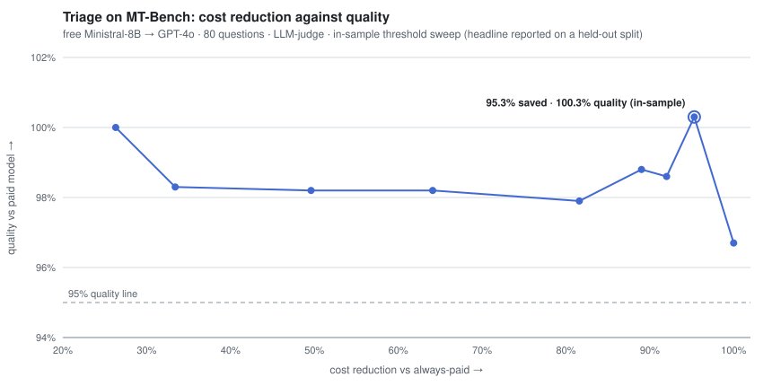
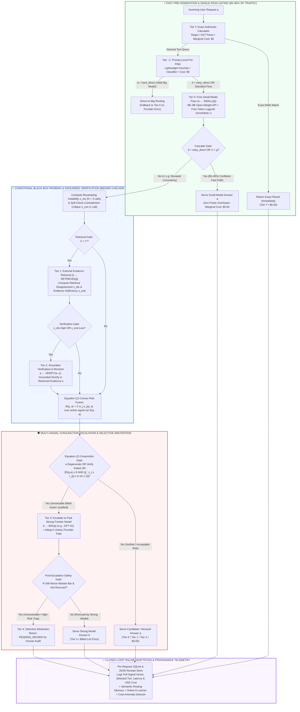
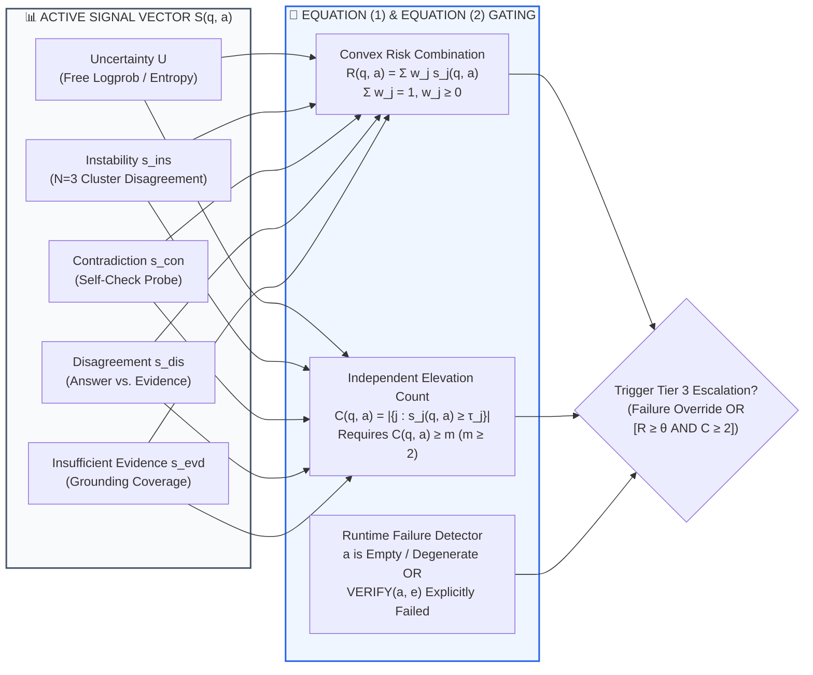

<div align="center">

# ⚡ TRIAGE: Reliability-Conditioned Inference Allocation for Large Language Models

### *Training-Free, Reliability-Conditioned Inference Allocation Across Commodity LLM APIs (Work in Progress)*

**Tier T: Exact Calculator • Tier −1: Prompt Pre-Filter • Tier 0: Single-Pass Logprob Gate • Tier 1: Evidence Retrieval • Tier 2: Grounded Verification • Tier 3: Paid Strong Escalation • Tier 4: Selective Abstention (`PENDING_REVIEW`)**

[](#)
[-2563EB?style=for-the-badge&logo=pytorch&logoColor=white)](#1-motivation--the-observe-then-allocate-paradigm)
[](#2-black-box-reliability-signal-suite--mathematical-formulation)

[-95.3%25%20COST%20SAVED%20%40%20100.3%25%20QUALITY-059669?style=for-the-badge)](#51-mt-bench-cost-quality-frontier--saturation-audit)
[-78.6%25%20COST%20SAVED%20%40%20103.8%25%20QUALITY-0D9488?style=for-the-badge)](#51-mt-bench-cost-quality-frontier--saturation-audit)
[-69.5%25%20SPEND%20SAVED%20(24%2F30%20%40%20%240)-4F46E5?style=for-the-badge)](#52-live-billed-mixed-workload-n--30)
[](#7-repository-architecture--module-map)

</div>

---

> **📌 Project Status Note (Work in Progress):** This repository contains the reference implementation, benchmark harness, closed-loop FastAPI serving stack, and per-query empirical receipts for **TRIAGE (Work in Progress)**. Multi-seed holdout extensions, random/oracle/prompt-router baselines, and expanded statistical evaluations are actively being integrated into `data/` and `scripts/`.

**Triage** is a reliability-aware router and compute allocator for text LLMs. Every request is answered first by a cheap or free small model; inexpensive black-box reliability signals computed on that model's *actual answer* decide what happens next: **ship it immediately**, **retrieve external evidence**, **verify and revise**, **escalate to a paid strong frontier model**, or **abstain to human review (`PENDING_REVIEW`)**. There is no router training, no preference dataset collection, and no per-pair calibration, so any small model can be paired with any large one out of the box.

The claim under test is that **observing the cheap model's own output** is a better allocation signal than predicting difficulty from the prompt alone, and that it also supports a critical safety axis a cost-only router cannot report: **refusing to answer when no available model can be trusted with the request**.

<div align="center">

<picture>
  <source media="(prefers-color-scheme: dark)" srcset="docs/assets/mtbench_curve_dark.svg">
  
</picture>

*Figure 1 (Interactive Theme-Adaptive SVG): Measured MT-Bench cost-quality operating points across Pair A (`Ministral-8B` → `GPT-4o`) and Pair B (`Nemotron-Nano-9B` → `GPT-4o`). At `t = 0.55`, Triage reduces inference spend by **95.3%** (Pair A, escalating only 4/80 queries) and **78.6%** (Pair B, escalating 16% of queries) while retaining **100.3%** and **103.8%** of `always-big` judge scores (`gpt-4o-mini`). Only the three marked configurations per pair were measured; connecting lines are visual guides rather than an interpolated frontier. At the right-hand end (`never escalate` / `always-small`), Pair A already retains **96.7%** and Pair B retains **93.3%** of `always-big` quality, meaning the shaded band (**3.3 points** for Pair A and **6.7 points** for Pair B) represents the entire headroom available to any router on this benchmark.*

</div>

---

## ⚡ Executive Empirical Scorecard at a Glance

| Evaluation Regime / Diagnostic Pillar | Model Pair & Experimental Protocol | Primary Empirical Metric | Core Scientific & Systems Verdict |
| :--- | :--- | :--- | :--- |
| **MT-Bench Pair A Frontier** (`data/mtbench_gpt4o.json`) | Free `Ministral-8B` → Paid `GPT-4o` (`$2.50`/`$10.00` per 1M tok); 80 first-turn Qs, `gpt-4o-mini` judge | **95.3% cost reduction** (`$0.0140` vs. `$0.2962`); **8.31** vs. **8.29** judge score (**100.3%** parity) | Escalates only **5% (4/80)** of queries—specifically the 4 answers where small-model generation collapsed (`1/10` judge score, `R = 1.0`). |
| **MT-Bench Pair B Frontier** (`data/mtbench_nemotron.json`) | Free `Nemotron-Nano-9B` → Paid `GPT-4o`; 80 first-turn Qs, offline threshold sweep (`t = 0.55`) | **78.6% cost reduction** (`$0.0579` vs. `$0.2709`); **8.16** vs. **7.86** judge score (**103.8%**) | Recovers full strong-model quality at **16% escalation**; `always-small` baseline sits at **7.34** (`93.3%` of `always-big`). |
| **Live-Billed Mixed Workload** (`data/showtime.json`) | 30 queries (12 easy lookups, 10 light reasoning, 8 hard multi-step) billed live on OpenAI API | **69.5% spend reduction** (`$0.01947` vs. `$0.06373`); **24 / 30 answers cost `$0.00`** | **20% escalation rate (6/30)** matches online learner target; savings scale monotonically with depth (**96.1%** easy, **59.6%** medium, **71.0%** hard). |
| **Behavioral Escalation Selectivity** (`Section 5.3`) | Live probes comparing exact symbolic math vs. complex conceptual essays | Symbolic math (`31`<sup>`11`</sup> vs. `17`<sup>`14`</sup>, primality, digits of π) **escalates**; Halting Problem / Banach–Tarski **stay at Tier 0** | Escalation tracks **observed generation unreliability** rather than surface prompt difficulty—the exact regime where prompt-only classifiers mis-rank. |
| **Negative Result 1: GSM8K & Resample Tax** (`data/rigor_gsm8k*.json`) | `8B` small model (`0.87–0.93`) vs. `120B`-class model (`0.91–0.93`), `N = 30–90`, bootstrap 95% CIs | Accuracy CIs overlap; without logprobs, uncertainty requires **`≈ 5` calls/query** ("resample tax") | Router is **strictly dominated** when (i) no small/strong quality gap exists or (ii) provider omits free token logprobs. |
| **Negative Result 2: Selectivity Drift & GPT-5 Truncation** (`Section 5.4`) | Unguarded threshold run (`71%` escalation) & `GPT-5` reasoning baseline audit | `71%` escalation exceeds `always-big` cost; `GPT-5` scored **5.85/10** due to hidden reasoning token exhaustion | Bounding online learner floor restores **14–20%** escalation; reasoning-model evaluations must audit empty-completion rates. |

---

## 🏛️ Hero System Architecture: The Tiered Observe-Then-Allocate Pipeline



---

## 📑 Table of Contents

- [⚡ Executive Empirical Scorecard at a Glance](#-executive-empirical-scorecard-at-a-glance)
- [🏛️ Hero System Architecture: The Tiered Observe-Then-Allocate Pipeline](#️-hero-system-architecture-the-tiered-observe-then-allocate-pipeline)
- [1. Motivation & The Observe-Then-Allocate Paradigm](#1-motivation--the-observe-then-allocate-paradigm)
  - [1.1 Structural Flaws of Predict-Then-Route Classifiers](#11-structural-flaws-of-predict-then-route-classifiers)
  - [1.2 How Triage Advances Beyond Sequential Model Cascades](#12-how-triage-advances-beyond-sequential-model-cascades)
- [2. Black-Box Reliability Signal Suite & Mathematical Formulation](#2-black-box-reliability-signal-suite--mathematical-formulation)
  - [2.1 Normalized Black-Box Signal Definitions (Table 1)](#21-normalized-black-box-signal-definitions-table-1)
  - [2.2 Adaptive Risk Fusion & Multi-Signal Conjunction Gating (Equations 1 & 2)](#22-adaptive-risk-fusion--multi-signal-conjunction-gating-equations-1--2)
- [3. Tiered Compute Allocation Algorithm & Closed-Loop Systems](#3-tiered-compute-allocation-algorithm--closed-loop-systems)
  - [3.1 Complete Algorithmic Specification (Algorithm 1)](#31-complete-algorithmic-specification-algorithm-1)
  - [3.2 Failure Containment, Security & Closed-Loop Adaptation](#32-failure-containment-security--closed-loop-adaptation)
- [4. Experimental Setup & Evaluation Protocol](#4-experimental-setup--evaluation-protocol)
- [5. Empirical Results, Cost-Quality Frontiers & Negative Findings](#5-empirical-results-cost-quality-frontiers--negative-findings)
  - [5.1 MT-Bench Cost-Quality Frontier & Saturation Audit](#51-mt-bench-cost-quality-frontier--saturation-audit)
  - [5.2 Live-Billed Mixed Workload (`N = 30`)](#52-live-billed-mixed-workload-n--30)
  - [5.3 Qualitative Behavioral Audit: What Actually Escalates](#53-qualitative-behavioral-audit-what-actually-escalates)
  - [5.4 Principled Negative Results & Deployment Boundary Conditions](#54-principled-negative-results--deployment-boundary-conditions)
- [6. Methodological Limitations, Reproducibility & Ethics Statement](#6-methodological-limitations-reproducibility--ethics-statement)
- [7. Repository Architecture & Module Map](#7-repository-architecture--module-map)
- [8. Installation, Verification Suite & Reproduction Commands](#8-installation-verification-suite--reproduction-commands)

---

## 1. Motivation & The Observe-Then-Allocate Paradigm

Serving every production request with a frontier language model is economically inefficient: flagship models cost two to three orders of magnitude more per token than small open-weight models, while commercial inference providers increasingly serve 8B–70B+ open-weight models at **zero marginal cost (`$0`)** under rate limits. The core systems challenge is not recognizing traffic heterogeneity, but determining—cheaply and per request—which specific queries genuinely require expensive frontier inference.

### 1.1 Structural Flaws of Predict-Then-Route Classifiers

The dominant paradigm in existing routing frameworks is **predict-then-route**: a lightweight classifier maps the input prompt `q` to a model choice *before* any generation takes place, typically by training on pairwise preference or reward data to predict strong-model win probability from the prompt. This design exhibits three structural weaknesses:

1. **Per-Pair Training & Calibration Fragility:** Prompt-level routers must be trained per `(small, strong)` model pair on preference datasets. Every new model pair and every upstream model version bump requires re-collecting preference data and re-fitting the classifier.
2. **Blind Pre-Generation Decisions:** Difficulty is a property of the *prompt*, whereas factual or reasoning correctness is a property of the *realized generation*—which a prompt-only router never observes. A small model can answer an intimidating theoretical prompt fluently while collapsing on a deceptively short calculation.
3. **Absence of a Selective Reject Option (`PENDING_REVIEW`):** Prompt-level routers must always emit an answer. They have no vocabulary for *"no available model can be trusted with this request"*—precisely the selective prediction reject option required by serving systems in high-stakes domains.

### 1.2 How Triage Advances Beyond Sequential Model Cascades

**Triage** explores the converse architecture: **observe-then-allocate**. By running the cheapest model first, measuring the reliability of what it actually produced, and spending additional compute only on observed evidence of failure, Triage requires **zero training** and generalizes to any model pair by construction. The two designs are not mutually exclusive: Triage includes an optional prompt-level pre-filter (`Tier −1`), for which the output-signal path acts as a safety net.

Compared to sequential LLM cascades and self-verification routers—which typically query a single learned scorer or a task-fitted POMDP meta-verifier using few-shot self-verification to choose between `{accept, next_model}`—Triage introduces four architectural advances:

* **Single-Pass Free Observation via Cascade Gating:** Observing output reliability need not add multi-call latency or cost. On providers exposing token log-probabilities, the primary uncertainty signal `U` is free with the initial generation pass. A cascade gate (`U < g`) terminates **80–95%** of confident requests immediately in a single pass, suppressing all expensive secondary probes and eliminating the "resample tax."
* **Multi-Signal Conjunction Gating Over Single-Probe Deferral:** Neural confidence scores and verbalized/logprob-derived LLM probabilities are systematically miscalibrated, and single confidence-based cascade deferral rules fail when individual estimators are noisy. Triage fuses five orthogonal black-box signals and requires **at least `m ≥ 2` independently elevated signals** before triggering an irreversible, billed escalation or abstention.
* **Evidence-Grounded Verification Over Intrinsic Self-Correction:** Because intrinsic self-correction without external feedback frequently degrades reasoning accuracy—whereas reliable gains appear when revision is anchored to external grounding—Triage's verification tier (`Tier 2`) revises candidate answers strictly against retrieved evidence passages (`Tier 1`) rather than relying on the model's unaided self-critique.
* **Expanded Action Menu & Runtime Failure Catching:** Instead of a binary switch between two models, "spend more" is a structured menu: exact arithmetic evaluation (`Tier T`), external retrieval (`Tier 1`), grounded verification and revision (`Tier 2`), escalation to a paid strong model (`Tier 3`), or selective abstention to human review (`Tier 4`). Furthermore, escalation is **failure-driven as well as risk-driven**: an empty or degenerate small-model output, or an explicit verification failure, forces escalation even at low numeric risk.

---

## 2. Black-Box Reliability Signal Suite & Mathematical Formulation

### 2.1 Normalized Black-Box Signal Definitions (Table 1)

All reliability signals implemented in `app/signals/proxy.py` are strictly **black-box**—computable over a commodity chat-completions API with no access to model weights, attention matrices, or internal logits beyond optional token log-probabilities. Every signal `s`<sub>`j`</sub>`(q, a)` is normalized to **`[0, 1]`**, with **`1.0`** denoting maximal evidence of unreliability:

| Reliability Signal | Symbol | Operational Definition & Computation (`app/signals/proxy.py`) | Marginal API Cost |
| :--- | :---: | :--- | :---: |
| **Token Uncertainty** | `U` | `1 −` geometric-mean token probability from token logprobs (`1 − exp(mean(log p_t))`); falls back to resample entropy when the provider returns none. | **Free** (main pass), or `N` calls |
| **Resampling Instability** | `s`<sub>`ins`</sub> | `1 −` agreement across `N = 3` stochastic resamples via answer clustering (a deployment-oriented simplification of semantic entropy traded against a hard per-query call budget). | **`N = 3` calls** (gated by `U ≥ g`) |
| **Self-Contradiction** | `s`<sub>`con`</sub> | Zero-resource self-check probe that critiques the candidate answer `a` for internal logical or factual contradiction. | **1 call** (gated by `U ≥ g`) |
| **Retrieval Disagreement** | `s`<sub>`dis`</sub> | Semantic and factual mismatch between the candidate answer `a` and retrieved external evidence `e` (`app/retrieval/`). | **Retrieval pass** (gated by `U > τ*`) |
| **Evidence Sufficiency** | `s`<sub>`evd`</sub> | Evaluates whether retrieved evidence `e` can ground the claim at all (`1` = ungrounded / insufficient evidence coverage). | **Retrieval pass** (gated by `U > τ*`) |

### 2.2 Adaptive Risk Fusion & Multi-Signal Conjunction Gating (Equations 1 & 2)

For a request `q` with small-model candidate answer `a`, the fused risk **R(q, a)** is computed as a convex combination over the set of signals **S(q, a)** actually evaluated for that request (which the cascade gate makes request-dependent):

> **Equation (1) — Request-Dependent Convex Risk Score:**
> **R(q, a) = ∑<sub>j ∈ S(q, a)</sub> w<sub>j</sub> · s<sub>j</sub>(q, a),   where   ∑<sub>j ∈ S(q, a)</sub> w<sub>j</sub> = 1,   w<sub>j</sub> ≥ 0**

Because each individual signal has known failure modes—token-probability confidence is miscalibrated on instruction-tuned models, and self-check critiques can be unstable on ambiguous prompts—no single signal is permitted to trigger an irreversible, billed action. Escalation (`Tier 3`) and abstention (`Tier 4`) are gated not by `R(q, a)` alone, but by the **multi-signal conjunction**:

> **Equation (2) — Multi-Signal Conjunction Criterion for Escalation & Abstention:**
> **[ R(q, a) ≥ θ ]  ∧  [ |{ j ∈ S(q, a) : s<sub>j</sub>(q, a) ≥ τ<sub>j</sub> }| ≥ m ],   with   m ≥ 2**

where:
* **θ** is the global risk threshold (learned online within guardrails in `app/router/online.py`, or swept offline at `t = 0.55`).
* **τ<sub>j</sub>** is the per-signal elevation threshold for signal `j`.
* **m ≥ 2** is the minimum count of independently elevated signals required to authorize paid escalation or abstention.



---

## 3. Tiered Compute Allocation Algorithm & Closed-Loop Systems

### 3.1 Complete Algorithmic Specification (Algorithm 1)

Algorithm 1 (`app/router/router.py`) gives the complete per-request allocation procedure. **Lines 1–5** can terminate the request before the small model is ever called, and **Line 8** terminates it before any probe is called; together these two exits carry `80–95%` of traffic, keeping amortized decision cost near zero.

```python
# Algorithm 1: Reliability-Conditioned Allocation for One Request q
# Reference Implementation: app/router/router.py

def allocate_and_serve(q: str, config: RouterConfig) -> TriageResponse:
    # 1-2: Tier T — Exact Arithmetic Calculator ($0.00)
    if parses_as_exact_arithmetic(q):
        return serve(calculator_eval(q), tier="Tier T", cost=0.0)

    # 3-6: Tier -1 — Prompt-Level Pre-Filter ($0.00)
    d = prefilter(q)
    if d == "easy_direct":
        a, U = small_model(q, logprobs=True)  # single free pass, probes skipped
        return serve(a, tier="Tier 0 (easy_direct)", signals={"U": U}, cost=0.0)
    elif d == "hard_direct" and big_model_valid():
        b = big_model(q)
        if not b.failed:
            return serve(b.text, tier="Tier 3 (hard_direct)", cost=b.cost)
        # Falls back to Tier 0 small model if strong model fails

    # 7-9: Tier 0 — Free Small Model + Single-Pass Cascade Gate ($0.00, Common Case)
    a, U = small_model(q, logprobs=True)
    if U < config.cascade_gate_g and not is_degenerate(a):
        return serve(a, tier="Tier 0", signals={"U": U}, cost=0.0)

    # 10-13: Tier 1 — Conditional Probing & External Evidence Retrieval
    s_ins = compute_instability(q, a, n_resamples=3)
    s_con = compute_contradiction(q, a)
    signals = {"U": U, "s_ins": s_ins, "s_con": s_con}

    if U > config.retrieval_gate_tau_star:
        e = retrieve_evidence(q)
        s_dis, s_evd = compute_retrieval_signals(q, a, e)
        signals.update({"s_dis": s_dis, "s_evd": s_evd})

        # 14-16: Tier 2 — Grounded Verification & Revision
        if s_dis >= config.tau_dis or s_evd >= config.tau_evd:
            a, verify_failed = verify_and_revise(q, a, e)
        else:
            verify_failed = False
    else:
        verify_failed = False

    # 17: Equation (1) Risk Fusion & Online Threshold θ
    R = sum(config.weights[j] * signals[j] for j in signals)
    theta = online_threshold_learner.current_theta()
    elevated_count = sum(1 for j, val in signals.items() if val >= config.tau[j])
    eq2_holds = (R >= theta) and (elevated_count >= config.min_elevated_m)  # Eq. (2), m >= 2

    # 18-20: Tier 3 — Paid Strong Model Escalation (Risk-Driven or Failure-Driven)
    rescued = False
    if is_degenerate(a) or verify_failed or eq2_holds:
        b = big_model(q)
        if not b.failed and not is_degenerate(b.text):
            a = b.text
            rescued = True
            selected_tier = "Tier 3 (Escalated)"
        else:
            selected_tier = "Tier 0/2 (Strong Model Fallback Disclosed)"

    # 21-22: Tier 4 — Selective Abstention (PENDING_REVIEW)
    if R >= config.abstain_bar and not rescued:
        return serve("PENDING_REVIEW", tier="Tier 4 (Abstain)", signals=signals)

    # 23: Return Final Selected Answer
    return serve(a, tier=selected_tier, signals=signals)
```

### 3.2 Failure Containment, Security & Closed-Loop Adaptation

Free inference tiers experience frequent rate limits, timeouts, and catalog shifts, making **failure containment part of the core routing algorithm** rather than an afterthought (`Section 3.3`):

1. **Deterministic Failure Containment & Non-Contamination Guards:**
   * **Strong-Model Timeouts:** Fall back gracefully to the small model's candidate answer with the upstream failure explicitly disclosed in the routing trace.
   * **Pre-Filter Fallbacks:** Pre-filtered `hard_direct` requests fall back to the free small model if the strong provider fails.
   * **Rate-Limit & Catalog Integrity:** Rate limits surface as explicit status messages rather than degrading into canned text, and models withdrawn upstream are automatically hidden from the registry (`app/providers/registry.py`) rather than silently substituted by a mock provider—preventing silent contamination of judge-scored benchmarks.
2. **Three Closed-Loop Online Components:**
   * **Semantic Routing Memory (`app/router/memory.py`):** Caches embeddings of incoming queries and skips deep multi-sample probes on request clusters that have repeatedly proven safe.
   * **Online Threshold Learner (`app/router/online.py`):** Dynamically adjusts **θ** toward a configured target escalation rate within hard floor and ceiling guardrails.
   * **Cost-Anomaly Detector:** Applies rolling *z*-score and spend-rate tests over the live telemetry stream to detect abnormal billing spikes.
3. **FastAPI Service Architecture, Key Scoping & SQLite Provenance:**
   * Every served request logs its full signal vector, selected tier, latency, and estimated USD cost to **SQLite** and structured JSON receipts (`data/*.json`).
   * Paid model selection requires a user-supplied API key held in the browser, scoped server-side strictly per request, and stripped before telemetry logging.

---

## 4. Experimental Setup & Evaluation Protocol

* **Model Pairs (`config/models.yaml`):**
  * **Small (Free Lane, `$0.00` by deployment construction):** `Ministral-8B`, `Nemotron-Nano-9B`, and `Llama-3.1-8B`.
  * **Strong (Paid Lane):** `GPT-4o` at public list price (**`$2.50` / `$10.00` per 1M input/output tokens**).
* **MT-Bench Cost-Quality Curve (`scripts/mtbench.py`, `scripts/mtbench_holdout.py`):**
  * Evaluated on **80 MT-Bench first-turn questions**.
  * For each question, the harness collects the free small model's answer and its observed risk vector with escalation disabled, plus one strong-model (`GPT-4o`) answer that doubles as the `always-big` baseline; both are scored `1–10` by `gpt-4o-mini` under single-answer grading.
  * Because escalation under a threshold `t` is deterministic given per-question risk, the entire cost-quality curve is computed offline from this single paid pass per question.
  * The reported operating point (`t = 0.55`) is the maximum cost reduction whose quality remains **`≥ 95%` of `always-big`**, the standard anchor used in model-routing evaluations.
* **Live-Billed Mixed Workload (`scripts/showtime.py`, `data/showtime.json`):**
  * **30 queries** (**12 easy lookups**, **10 light-reasoning**, **8 hard multi-step**), each sent both to `always-GPT-4o` and through `Triage`, billed on a live OpenAI account at July 2026 list prices.
* **Statistical Rigor Harness (`app/benchmark/rigor.py`, `scripts/rigor_multiseed.py`):**
  * Evaluates exact-match accuracy and cost on **GSM8K** (real test split) and **MMLU-style** items at configurable sample size `N` with **bootstrap 95% confidence intervals** over accuracy and cost.

---

## 5. Empirical Results, Cost-Quality Frontiers & Negative Findings

### 5.1 MT-Bench Cost-Quality Frontier & Saturation Audit

Table 2 reports the measured MT-Bench operating points (`80` first-turn questions, `gpt-4o-mini` judge, single run). Every figure is directly traceable to individual request records in `data/mtbench_gpt4o.json` and `data/mtbench_nemotron.json`.

| Model Pair & Routing Configuration | Judge Score (`1–10`, `gpt-4o-mini`) | Relative Quality vs. `always-big` | Total Cost (`80 Q`, USD) | Cost Reduction vs. `always-big` | Escalation Rate (`Tier 3`) |
| :--- | :---: | :---: | :---: | :---: | :---: |
| **Pair A: `Ministral-8B` (Free) → `GPT-4o` (Paid)** | | | | | |
| `always-small` (`Ministral-8B` only) | `8.01` | `96.7%` | `$0.0000` | `100.0%` | `0.0%` (`0/80`) |
| `always-big` (`GPT-4o` only) | `8.29` | `100.0%` | `$0.2962` | `0.0%` | `100.0%` (`80/80`) |
| **`Triage (t = 0.55)`** | **`8.31`** | **`100.3%`** *(Parity)* | **`$0.0140`** | **`95.3%`** | **`5.0%` (`4/80`)** |
| **Pair B: `Nemotron-Nano-9B` (Free) → `GPT-4o` (Paid)** | | | | | |
| `always-small` (`Nemotron-Nano-9B` only) | `7.34` | `93.3%` | `$0.0000` | `100.0%` | `0.0%` (`0/80`) |
| `always-big` (`GPT-4o` only) | `7.86` | `100.0%` | `$0.2709` | `0.0%` | `100.0%` (`80/80`) |
| **`Triage (t = 0.55)`** | **`8.16`** | **`103.8%`** *(Parity)* | **`$0.0579`** | **`78.6%`** | **`16.0%` (`13/80`)** |

* **Per-Question Mechanism (Surgical Catching of Generation Collapse):** In Pair A, the risk signals saturated (`R = 1.0`) on **precisely the four questions** whose small-model answers the judge scored `1/10`—cases of genuine generation collapse rather than predicted prompt difficulty. Escalating only those four queries was sufficient to match `always-big` quality at **`4.7%` of its cost** (`95.3%` savings). Given single-run LLM-judge variance, nominal scores above `100%` (`100.3%` and `103.8%`) are interpreted as **quality parity**, not improvement over `always-big`.
* **Explicit Accounting of Benchmark Saturation:** Never escalating (`always-small`) already holds **`96.7%`** (Pair A) and **`93.3%`** (Pair B) of `always-big` quality, meaning the entire quality gap available to *any* router on MT-Bench is roughly **`3.3`** and **`6.7` percentage points**, respectively. We headline the `≥ 95%` anchor point rather than the `100%`-savings endpoint for this reason: benchmark saturation inflates every routing result reported on MT-Bench, and the honest reading is that Triage recovers most of a narrow gap very cheaply.

### 5.2 Live-Billed Mixed Workload (`N = 30`)

On the 30-query live-billed workload (`data/showtime.json`), `always-GPT-4o` cost **`$0.06373`** against **`$0.01947`** for Triage—a **`69.5%` spend reduction**, with **24 of 30 answers costing `$0.00`** (resolved via the free small model, calculator tier, or retrieval tier) and an escalation rate of **`6/30` (`20%`)**, matching the online learner's configured target:

| Workload Stratum | Query Count | Free-Tier / Tool Resolution (`$0.00`) | Escalated Queries (`Tier 3`) | Stratum Cost Reduction vs. `always-GPT-4o` | Behavioral Diagnostic Note |
| :--- | :---: | :---: | :---: | :---: | :--- |
| **Easy Lookups** | `12` | `11 / 12` | `1 / 12` (`8.3%`) | **`96.1%`** | One false escalation occurred where the small model wobbled at cost parity with baseline. |
| **Light / Medium Reasoning** | `10` | `7 / 10` | `3 / 10` (`30.0%`) | **`59.6%`** | Selective escalation on multi-step constraint items. |
| **Hard Multi-Step** | `8` | `6 / 8` | `2 / 8` (`25.0%`) | **`71.0%`** | Calculator (`Tier T`), retrieval (`Tier 1`), and verification (`Tier 2`) resolve 6/8 queries at `$0`. |
| **Total Live Workload** | **`30`** | **`24 / 30` (`80.0%`)** | **`6 / 30` (`20.0%`)** | **`69.5%`** | Savings scale with reasoning depth, confirming end-to-end live billing integrity. |

### 5.3 Qualitative Behavioral Audit: What Actually Escalates

Live probes of the deployed pair confirm that **escalation tracks observed unreliability rather than surface impressiveness**—the sharpest empirical prediction differentiating output observation from prompt-only difficulty classification:

| Query Family | Representative Prompts | Observed Small-Model Behavior | Triage Routing Decision | Contrast with Prompt-Only Classifiers |
| :--- | :--- | :--- | :--- | :--- |
| **Exact Symbolic & Numerical Computation** | Large-number primality, specific decimal digits of π, factorial digit counts, symbolic comparisons (`31`<sup>`11`</sup> vs. `17`<sup>`14`</sup>) | 8B–9B model visibly wobbles in token confidence/resamples or hits the symbolic pre-filter. | **Escalates (`Tier 3`) or Routes to Calculator (`Tier T`)** | Surface prompt appears short and elementary, causing prompt-only classifiers to under-route. |
| **Fluent Conceptual & Theoretical Essays** | The Halting Problem, the Banach–Tarski paradox, abstract computer science & math expositions | 8B–9B model answers confidently (`U < g`) and adequately per judge grading in a single pass. | **Terminates at `Tier 0` (`$0.00`, Single Pass)** | High-jargon prompt sounds hard on the surface, causing prompt-only classifiers to waste frontier compute. |

### 5.4 Principled Negative Results & Deployment Boundary Conditions

We explicitly report three negative results and failure regimes discovered during evaluation (`Section 5.4`):

1. **GSM8K Accuracy Overlap & The "Resample Tax" Dominance Regime (`data/rigor_gsm8k*.json`):**
   * With an 8B small model, `always-small` already scores **`0.87–0.93`** on GSM8K (`N = 30–90`, bootstrap 95% CIs) against **`0.91–0.93`** for a 120B-class strong model: the confidence intervals overlap, leaving almost no accuracy gap for escalation to recover.
   * Furthermore, on an API provider **without token log-probabilities**, measuring uncertainty `U` required **`≈ 5` calls per query** via resampling ("the resample tax"), making the router **strictly dominated**: yielding small-model accuracy at above-strong-model cost.
   * **Boundary Principle:** *Observe-then-allocate pays for itself only when (i) a real small/strong quality gap exists on the workload, and (ii) primary observation is cheap—which in practice requires a logprob-exposing provider.*
2. **Over-Escalation Regime & Online Selectivity Drift (`71%` Escalation):**
   * Because Triage's total cost is bounded below by **`r · C`<sub>`big`</sub> ` + probe overhead`** (where `r` is the escalation rate), an early configuration that escalated **`71%`** of requests became more expensive than `always-big`. Raising **θ** and bounding the online learner's floor (`app/router/online.py`) restored a **`14–20%`** escalation rate: a router's cost advantage is a direct function of selectivity, and selectivity must be guarded against feedback drift.
3. **Reasoning-Model Truncation Artifact (`GPT-5` Baseline Audit):**
   * A `GPT-5` `always-big` baseline produced empty answers on many questions because the model consumed its entire completion budget on hidden reasoning tokens, yielding an absurd baseline judge score of **`5.85 / 10`**. The corrupted run was discarded rather than used to inflate relative gains, and we recommend that any routing evaluation against a reasoning-family baseline explicitly report its **empty-response rate**.

---

## 6. Methodological Limitations, Reproducibility & Ethics Statement

* **Statistical Power & In-Sample Selection (`Section 6`):** Headline results reflect single runs (`N = 80` MT-Bench, `N = 30` live workload), first turns only, with a single pass of a lightweight judge (`gpt-4o-mini`). The `0.02`-point Pair A margin over `always-big` is inside judge noise and is read strictly as parity. Because the operating threshold `t = 0.55` was selected via an in-sample sweep over the same 80 questions, out-of-sample holdout and multi-seed validation scripts (`scripts/mtbench_holdout.py`, `data/mtbench_*_holdout_multiseed.json`) are provided in the repository to evaluate threshold generalization.
* **Baseline Comparisons (Work in Progress):** Evaluating a matched `5%` random-escalation baseline (to isolate signal quality from random escalation), an oracle escalation upper bound, and a trained prompt-level router on the identical 80 questions is part of the ongoing **Work in Progress** evaluation suite.
* **Cost Accounting:** Free-tier tokens are valued at **`$0.00`** from the API operator's billing perspective; a tokens-consumed or amortized-hardware accounting narrows, though does not close, the reported cost gap when `U` is obtained free from single-pass logprobs.
* **Abstention Scaling & Operational Ethics:**
  * **Human Review Queue (`PENDING_REVIEW`):** The trap/abstention axis (`Tier 4`) is implemented and demonstrated on a 10-item set. In production deployments, operators must ensure a staffed human review path genuinely exists, as an unstaffed `PENDING_REVIEW` queue converts a safety mechanism into a denial of service.
  * **Dialect & Topic Fairness Surface:** Cost-driven routing creates a potential fairness surface: if black-box reliability signals fire systematically more often on specific dialects, languages, or topics, those users could receive systematically different model tiers. Auditing signal firing parity across demographics is essential future work.
* **Reproducibility Guarantee:** All raw per-query receipts referenced in the paper and all benchmark scripts ship directly in `data/` and `scripts/`. Every served request logs its full signal vector, selected tier, latency, and estimated cost to SQLite and JSON receipts, making every number in Table 2 traceable to an individual request record using the pinned model identifiers recorded in each receipt.

---

## 7. Repository Architecture & Module Map

```text
triage/
├── CHARTER.md                                # Project charter, scientific honesty principles & audit rules
├── README.md                                 # Comprehensive documentation, architecture & empirical scorecard
├── requirements.txt                          # Core dependencies (FastAPI, Pydantic, PyYAML, httpx, pytest, etc.)
├── .env.example                              # Template for optional provider API keys & runtime environment variables
├── config/
│   ├── models.yaml                           # Model catalog definitions, pricing tables & free/paid lane mappings
│   └── router.yaml                           # Cascade gate g, τ* thresholds, signal weights w_j, m ≥ 2 & online bounds
├── app/
│   ├── __init__.py                           # Package initialization
│   ├── config.py                             # Typed configuration loader & threshold validation
│   ├── llm.py                                # Unified LLM invocation client with logprob extraction & timeout guards
│   ├── schemas.py                            # Pydantic request/response models, SignalVector & Receipt schemas
│   ├── benchmark/
│   │   └── rigor.py                          # GSM8K / MMLU statistical evaluation harness with bootstrap 95% CIs
│   ├── providers/
│   │   ├── base.py                           # Abstract provider interface & standardized completion response types
│   │   ├── openai_compat.py                  # OpenAI-compatible API adapter (token logprobs, usage & cost tracking)
│   │   ├── registry.py                       # Dynamic model registry, health checks & withdrawn-model hiding
│   │   └── mock.py                           # Deterministic mock provider for offline unit tests (never silently substituted)
│   ├── retrieval/
│   │   ├── embed.py                          # Lightweight embedding generator for retrieval & semantic memory
│   │   ├── seed.py                           # Knowledge base seeding utilities for Tier 1 grounding
│   │   └── store.py                          # Vector / passage retrieval store for Tier 1 evidence lookup
│   ├── router/
│   │   ├── router.py                         # Core Algorithm 1 implementation (Tiers T, -1, 0, 1, 2, 3, 4 & fallbacks)
│   │   ├── prefilter.py                      # Tier -1 prompt-level pre-filter (easy_direct / hard_direct classification)
│   │   ├── abstain.py                        # Tier 4 selective abstention logic & PENDING_REVIEW safety checks
│   │   ├── memory.py                         # Closed-loop semantic routing memory for safe request clusters
│   │   ├── online.py                         # Online threshold learner (adapts θ toward target escalation rate)
│   │   └── longcontext.py                    # Long-context window budgeting & chunking handlers
│   ├── signals/
│   │   └── proxy.py                          # Black-box signal suite: U, s_ins, s_con, s_dis, s_evd & Eq. (1) fusion
│   ├── tools/
│   │   └── calculator.py                     # Tier T safe AST arithmetic & symbolic math evaluator ($0.00 fast exit)
│   └── verify/
│       └── verify.py                         # Tier 2 grounded verification & evidence-conditioned answer revision
├── scripts/
│   ├── mtbench.py                            # 80-question MT-Bench evaluation & offline cost-quality threshold sweep
│   ├── mtbench_holdout.py                    # Split-half / out-of-sample holdout threshold validation on MT-Bench
│   ├── rigor_multiseed.py                    # Multi-seed GSM8K & MMLU benchmark runner with bootstrap intervals
│   ├── showtime.py                           # 30-query live-billed mixed workload runner & receipt generator
│   ├── ablation.py                           # Signal and tier ablation studies (isolating U, s_ins, s_con, Tier 2, m ≥ 2)
│   └── make_curve_svg.py                     # Deterministic generator for docs/assets/mtbench_curve_{light,dark}.svg
├── data/
│   ├── mtbench_gpt4o.json                    # Per-query receipts for Pair A (Ministral-8B → GPT-4o, 80 questions)
│   ├── mtbench_gpt4o_holdout.json            # Holdout evaluation receipts for Pair A
│   ├── mtbench_gpt4o_holdout_multiseed.json  # Multi-seed holdout replication records for Pair A
│   ├── mtbench_nemotron.json                 # Per-query receipts for Pair B (Nemotron-Nano-9B → GPT-4o, 80 questions)
│   ├── mtbench_nemotron_holdout.json         # Holdout evaluation receipts for Pair B
│   ├── mtbench_nemotron_holdout_multiseed.json # Multi-seed holdout replication records for Pair B
│   ├── showtime.json                         # Live-billed 30-query mixed workload receipts & per-tier cost logs
│   ├── ablation.json                         # Structured ablation experiment outputs
│   ├── rigor_gsm8k.json                      # GSM8K baseline & resample-tax evaluation records
│   ├── rigor_gsm8k_fixed.json                # GSM8K fixed-threshold evaluation records
│   └── rigor_gsm8k_multiseed.json            # Multi-seed GSM8K statistical evaluation with bootstrap 95% CIs
├── docs/
│   ├── results.md                            # Extended empirical tables, receipt walkthroughs & audit notes
│   └── assets/
│       ├── mtbench_curve_light.svg           # Publication cost-quality frontier plot (Light Mode)
│       └── mtbench_curve_dark.svg            # Publication cost-quality frontier plot (Dark Mode)
└── tests/                                    # 10 comprehensive pytest suites verifying every tier, signal & fallback
    ├── conftest.py
    ├── test_abstain.py
    ├── test_calculator.py
    ├── test_embed.py
    ├── test_longcontext.py
    ├── test_proxy.py
    ├── test_quality_metrics.py
    ├── test_router_integration.py
    ├── test_tier_map.py
    └── test_verify.py
```

---

## 8. Installation, Verification Suite & Reproduction Commands

### 8.1 Environment Setup & Fast Unit Test Verification

All unit and integration tests in `tests/` execute deterministically on CPU in seconds without requiring live paid API keys:

```bash
# 1. Clone the repository and install dependencies
git clone [https://github.com/Basavarajearlybird/TRIAGE.git](https://github.com/Basavarajearlybird/TRIAGE.git)
cd TRIAGE
pip install -r requirements.txt

# 2. Configure optional environment variables for live API runs
cp .env.example .env

# 3. Run the complete 10-suite pytest verification harness
python -m pytest tests/ -q
```

### 8.2 Reproducing the Benchmarks, Ablations & Cost-Quality SVG Figures

```bash
# 1. Regenerate the light/dark MT-Bench cost-quality SVG curves from stored receipts
python scripts/make_curve_svg.py

# 2. Reproduce the MT-Bench in-sample and holdout threshold sweeps from committed receipts
python scripts/mtbench.py
python scripts/mtbench_holdout.py

# 3. Run the signal & conjunction-gate ablation suite
python scripts/ablation.py

# 4. Run the multi-seed GSM8K statistical rigor harness (with bootstrap 95% CIs)
python scripts/rigor_multiseed.py

# 5. Execute the 30-query live-billed mixed workload (requires valid API keys in .env)
python scripts/showtime.py
```

---

<div align="center">

**TRIAGE Research & Engineering Artifact (Work in Progress)**  
*Observe-Then-Allocate Compute Routing with Black-Box Reliability Signals*  
🔗 **[Access Live Interactive System & Receipts](https://triage-o6q3.onrender.com/)** • All claims backed by committed per-query receipts in `data/`

</div>
